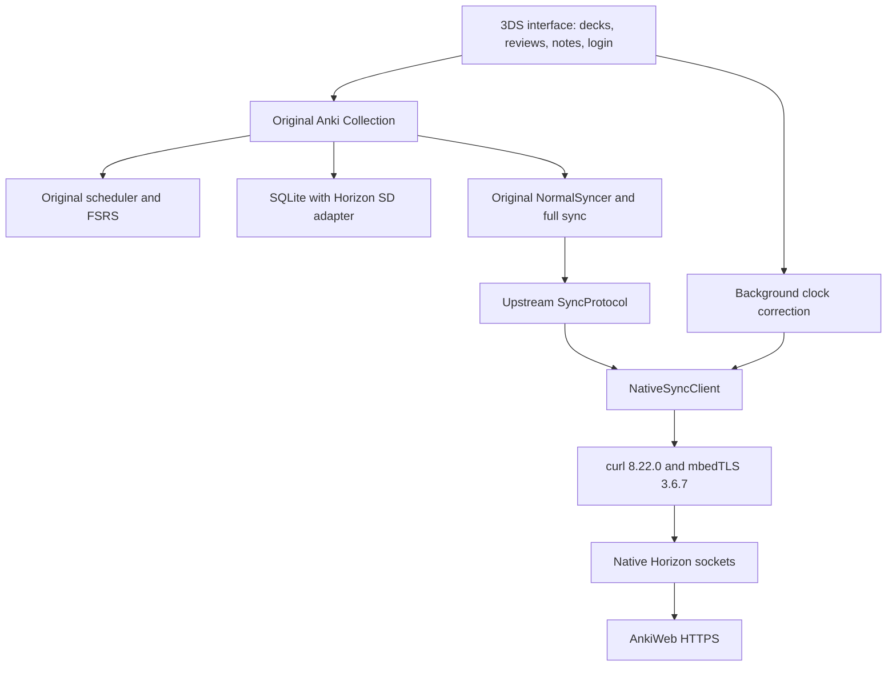

# Anki 3DS

An unofficial native port of Anki for the original Nintendo 3DS. It uses Anki's
Rust backend for collections, FSRS scheduling, note editing, search, undo, and
synchronization. The interface uses both screens and the Nintendo keyboard.

The console runs the application itself. A computer builds the executable and
can transfer files; it is not needed while studying or connecting to AnkiWeb.



## What works

Offline study, four ratings, learning-card recurrence, note creation/editing,
search, deck limits, statistics, and undo run in Azahar's Old 3DS mode.
The app opens without a network connection or timezone setup. Clock detection runs
in the background; failed checks preserve study and unsaved note drafts. The UI
supports English and Spanish, selected from the console language or the menu.

Collection sync uses the original engine. Login uses a masked keyboard; credentials
stay in memory until exit. Sync shows live stages, transfer counts, and an animated
indicator. A full sync requires confirmation before replacing either collection.
TLS verifies certificates and hostnames; there is no insecure fallback.

See [current verification and limits](3ds/docs/FEASIBILITY.md). Authenticated
production AnkiWeb sync and the final application package still require separate
verification. Use disposable collections until those gates are complete.

## Test evidence

The port runs Anki's existing test bodies and assertions. These counts distinguish
native execution from desktop checks; overlapping suites are not added together.

| Original Anki suite                                    | Environment                   | Observed result                                               |
| ------------------------------------------------------ | ----------------------------- | ------------------------------------------------------------- |
| Rust workspace, including `rslib`                      | macOS                         | **767 passed**, 0 skipped; 747 are core `rslib` tests         |
| Collection/sync regression subset                      | macOS                         | **38 passed**, 0 failed                                       |
| Offline backend and utility tests                      | Azahar, Old 3DS mode          | **697 passed, 16 failed** across 713 attempted original tests |
| Scheduler subset, including FSRS, answering and queues | Azahar, Old 3DS mode          | **133/133 passed**                                            |
| Deck configuration subset                              | Azahar, Old 3DS mode          | **52/52 passed**                                              |
| Python collection compatibility suite                  | macOS, checkout-built backend | **184 passed**                                                |

The remaining native unit failures cover unsupported filesystem/process operations,
shared-WAL gaps, and an emulator filesystem mismatch. The native offline test
configuration excludes 41 network-gated tests; it does not count them as passes.
The native unit aggregate is earlier evidence, not a fresh rerun of the current app.

Separately, the native application runs the original `NormalSyncer` against Anki's
original desktop sync server over validated TLS. Seven disposable incremental
cases match desktop results and an independent SQL oracle: unchanged collections,
local edits, remote edits, disjoint edits, review history, deletions, and conflicts.
Full upload/download, cancellation, interruption/recovery, corrupt download rejection,
and certificate/hostname rejection have also passed controlled emulator tests.
These are collection integration cases, not extra upstream unit-test counts.

A physical Old 3DS report records ten Phase 4 engine cases passing. Its independent
database comparison remains incomplete. The final application build has not yet
been tested on hardware or authenticated against production AnkiWeb.

Reproduce desktop sync checks with `just old3ds-sync-regression`. Native upstream
registration, fixtures, and comparison code live in [3ds/testing](3ds/testing).
Raw logs and databases remain under ignored `out/3ds/testing`, `out/3ds/app-sync`,
and `out/3ds/logs`; [port status](3ds/docs/FEASIBILITY.md) names the current records.

## Build

Install devkitPro's 3DS tools, Rust nightly with `rust-src`, `cargo-3ds`, and protoc.
Versions and environment are in [toolchain.sh](3ds/toolchain.sh).

```sh
just old3ds-https-libs
just old3ds-app-build
just old3ds-app-package
```

The ZIP contains one executable with an embedded CA bundle. First launch creates
its SD folder and certificate file, preserving existing files. It does not replace
an existing collection. The application opens `sdmc:/3ds/anki-3ds/prototype.anki2`, creating an empty
collection if the file does not exist.
The app opens offline without timezone setup. It follows the console clock until
its first successful automatic clock check, then retains that correction for
offline use. A background worker reads UTC from a validated AnkiWeb HTTPS response
when connected; sync refreshes it again. The displayed clock remains the console's
local time. Menu can request an automatic clock update.

## Source layout

- [`3ds/app`](3ds/app): UI, language catalogs, background sync, and application packaging.
- [`3ds/sync-transport`](3ds/sync-transport): HTTPS, DNS, entropy, SOC ownership, and file transport.
- [`3ds/sqlite-vfs`](3ds/sqlite-vfs): native SQLite SD access and locking.
- [`rslib`](rslib): original Anki backend, with narrow portability feature gates.
- [`3ds/testing`](3ds/testing) and probe crates: disposable fixtures and native regression evidence.

The upstream Python, Qt, web, protocol, and build sources remain for desktop
validation and future upstream merges. They are not included in the 3DS executable.
Generated collections, screenshots, logs, toolchains, and build caches belong in
ignored `out/`, not the source tree. Fork-only release, publishing, and issue bots
have been removed.

## License

Based on [Anki](https://github.com/ankitects/anki), by Ankitects and contributors.
This project is not endorsed by Ankitects or Nintendo. Upstream copyright notices
and licenses are retained. See [LICENSE](LICENSE).
