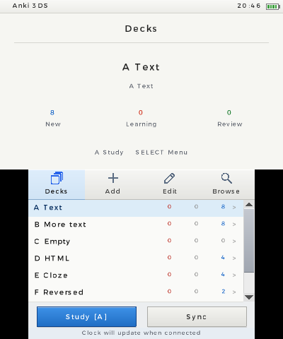
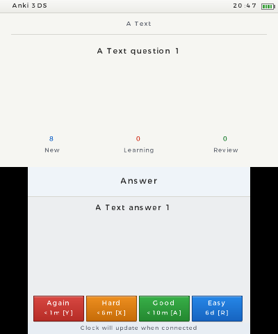

# Anki 3DS

An unofficial Anki port for the original Nintendo 3DS. Collections, scheduling,
FSRS and synchronization use Anki's Rust backend. The console runs independently;
a computer is only needed to build or transfer files.

## Install

Download a build from [Releases](https://github.com/AlexMolina08/anki-3ds/releases).

| Format | Installation |
| --- | --- |
| `.3dsx` | Copy to `SD:/3ds/anki-3ds/anki-3ds.3dsx`, then open Homebrew Launcher. |
| `.cia` | Copy to the SD card, select it in FBI and install. Open Anki 3DS from HOME Menu. |

Both formats use `SD:/3ds/anki-3ds/` for the collection, saved login and settings.
Back up this folder before testing or upgrading. Replace the executable or install
an updated CIA without deleting the folder. The ZIP includes both formats,
licenses and a build manifest; `SHA256SUMS` accompanies each release.

Press SELECT for the menu. **Log in** checks AnkiWeb authentication and saves the
session without transferring a collection. **Sync** reuses that login. Full sync
asks for a direction and confirmation before replacing a collection. **Log out**
removes the saved login from SD. Passwords are not saved; stored session tokens
are plaintext credentials and should not be shared.

English and Spanish follow the console language, with a menu override.
[Controls and storage details](3ds/app/README.md).

## Screenshots

Captured from the installed CIA in Azahar’s Old 3DS mode, using a disposable
collection. These are emulator captures, not photographs of physical hardware.

| Decks | Review |
| --- | --- |
|  |  |

## Status

Offline reviews, note editing, search, undo, deck limits, and collection sync run
in Azahar's Old 3DS mode. Official AnkiWeb login and saved-token reuse after
restart have also passed there. This release still needs physical Old 3DS testing.
Media sync, media playback and CSS card rendering are not supported.

The application opens offline. When needed, a background HTTPS request corrects
its clock; login and sync reuse a correction checked within the last 30 minutes.
Certificate and hostname verification remain enabled. Use a developer account and
a disposable collection for initial hardware testing.

## Build your own binaries

Clone the repository, including its translation submodules:

```sh
git clone --recurse-submodules https://github.com/AlexMolina08/anki-3ds.git
cd anki-3ds
```

### Pinned Linux container

Install Docker, Python 3.11+ and [just](https://github.com/casey/just). From a clean
checkout, run:

```sh
just old3ds-container-release
```

This uses the devkitPro image pinned by digest in
[`3ds/dependencies.json`](3ds/dependencies.json), prepares the Rust toolchain,
compiles native dependencies, and builds both formats. On Apple Silicon it runs
the Linux amd64 image through Docker's emulation. The same entry point runs in CI.
The container installs host packages from Debian's repositories; builds record
pinned project inputs but are not claimed to be byte-identical across hosts.

### Native macOS or Linux

Install:

- devkitPro's `3ds-dev` group, including devkitARM, libctru, Citro2D and Citro3D;
- Rustup, Python 3.11 with current security updates, CMake 3.28+, a host C/C++
  compiler, Make, Patch, Git, curl, protoc and just 1.58.0.

The development machine uses devkitARM r68/GCC 16.1.0, libctru 2.7.0, Citro2D
1.7.0 and Citro3D 1.7.1. Set `DEVKITPRO` if it is not installed at
`/opt/devkitpro`. Then run:

```sh
just old3ds-setup
just old3ds-release
```

Setup installs Rust `nightly-2026-10-12` with `rust-src` and `cargo-3ds` 0.1.5.
It fetches the pinned CA bundle and compatibility crate with SHA-256 checks,
builds curl 8.22.0/mbedTLS 3.6.7, and builds makerom 0.19.0/bannertool 1.2.3
from verified source archives. No Anki desktop installation, private credentials,
or pre-existing `out/` directory is required for these builds.

For individual stages after setup:

```sh
just old3ds-app-build       # ARMv6K/VFPv2 ELF and Homebrew Launcher executable
just old3ds-app-cia         # CIA from that release ELF
just old3ds-app-package     # ZIP, manifest and SHA256SUMS
```

Outputs are in `out/3ds/app/`:

- `anki-3ds.3dsx`
- `anki-3ds.cia`
- `anki-3ds-<version>.zip`
- `manifest.json` and `SHA256SUMS`

Packaging rejects stale binaries and emulator builds. The manifest records the
source revision, dirty-tree state, source-input hashes and artifact hashes.
`ANKI_3DS_RELEASE=1` additionally requires a clean checkout. The CIA uses title ID
`000400000F3A1000`, Old 3DS memory mode and 268 MHz CPU settings; it does not
request New 3DS-only resources. Keep this ID stable for upgrades.

## Automated checks and releases

Pushes to `main` and pull requests build both native formats and retain artifacts
and logs. Backend changes under `rslib/`, `proto/`, `ftl/`, `pylib/` or root Cargo
configuration also run the **original Anki Rust workspace tests and Python
collection compatibility tests**. Packaging/UI-only changes do not rerun those
suites. A manual CI dispatch runs them explicitly.

These are the original tests, not replacement scheduler or sync tests. Previous
observed results, preserved without rerunning them for release packaging:

| Suite | Environment | Recorded result |
| --- | --- | --- |
| Rust workspace | macOS | 767 passed, including 747 core `rslib` tests |
| Python collection compatibility | macOS | 184 passed |
| Backend and utilities | Old 3DS emulation | 697 passed, 16 failed across 713 attempted tests |
| Scheduler subset, including FSRS | Old 3DS emulation | 133/133 passed |
| Deck configuration subset | Old 3DS emulation | 52/52 passed |

The native subsets overlap; their counts must not be added. Native failures
include unsupported filesystem/process operations and shared-WAL limitations.
The native offline configuration excludes 41 network-gated tests. Separate
collection integration runs compare the original sync engine with Anki's desktop
server and an independent SQL oracle. [Verification record](3ds/docs/FEASIBILITY.md).

For a release, update the version in `3ds/app/Cargo.toml` and its lockfile, edit
`3ds/RELEASE_NOTES.md`, commit and push to `main`, then push a matching `vX.Y.Z`
tag. The release workflow waits for that commit's successful main-branch CI run,
verifies its artifact checksums and source revision, and publishes those exact
files as an experimental GitHub release. It does not rebuild or rerun tests.

A new CIA can be checked separately with
`just old3ds-app-cia-smoke LABEL` on macOS with Azahar. It installs and opens the
CIA in a fresh Old 3DS emulator profile; it does not run the Anki test suites or
use a personal collection. `ANKI_3DS_AZAHAR` selects the emulator executable.

## Source layout

- [`3ds/app`](3ds/app): interface, account handling, native builds and packaging.
- [`3ds/sync-transport`](3ds/sync-transport): HTTPS, DNS, entropy and SOC ownership.
- [`3ds/sqlite-vfs`](3ds/sqlite-vfs): Horizon SD storage adapter.
- [`rslib`](rslib): Anki backend, with narrow platform feature gates.
- [`3ds/testing`](3ds/testing): original test runners and compatibility comparisons.

Probe crates and their lockfiles remain as reproducible platform diagnostics.
Generated binaries, collections, credentials, test captures and logs belong in
ignored `out/`. Upstream Python, Qt, web, protocol sources and licenses remain
available for compatibility checks and upstream merges.

## License

Based on [Anki](https://github.com/ankitects/anki), by Ankitects and contributors.
Not endorsed by Ankitects or Nintendo. Upstream copyright notices and licenses
are retained. See [LICENSE](LICENSE).
